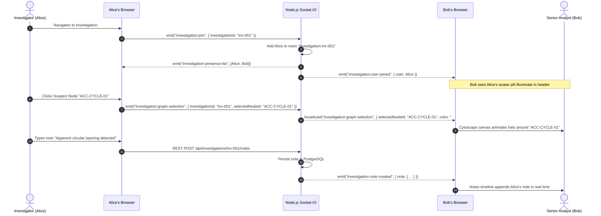

# System Architecture: Collaborative Graph-Based Fraud Detection Console

## 1. Executive Architecture Summary

The **Collaborative Graph-Based Fraud Detection Console** is an enterprise-grade, distributed intelligence platform engineered to detect, analyze, and remediate sophisticated financial crime topologies—including circular routing (round-tripping), structuring/smurfing (fan-in aggregation), rapid disbursement (fan-out dispersion), and coordinated syndicate rings.

The platform employs a **Dual-Mode Polyglot Storage Architecture** coupled with an event-driven **Real-Time Collaboration Engine** and an interactive **GPU-Accelerated Topology Visualization Canvas**.

```
┌─────────────────────────────────────────────────────────────────────────────────────────────┐
│                                   PRESENTATION LAYER (CLIENT)                              │
│  React 19 • TypeScript • Vite • Tailwind CSS • Cytoscape.js • Cola/CoSE • Zustand • Axios    │
└───────────────────────────────┬─────────────────────────────┬───────────────────────────────┘
                                │ HTTPS / REST                │ WSS / WebSocket (Socket.IO)
                                ▼                             ▼
┌─────────────────────────────────────────────────────────────────────────────────────────────┐
│                                APPLICATION SERVER (EXPRESS + NODE.JS)                       │
│  ┌───────────────────────┐  ┌────────────────────────┐  ┌────────────────────────────────┐  │
│  │ REST Routing & Auth   │  │ Collaboration Socket   │  │ Graph Analytics Engine         │  │
│  │ JWT / RBAC Middleware │  │ Room & Presence Engine │  │ BFS, DFS, Johnson, Louvain     │  │
│  └───────────┬───────────┘  └───────────┬────────────┘  └───────────────┬────────────────┘  │
│              │                          │                               │                   │
│              ▼                          ▼                               ▼                   │
│  ┌───────────────────────────────────────────────────────────────────────────────────────┐  │
│  │                     Polyglot Storage & In-Memory Adapter Abstraction                  │  │
│  └──────────────────────────────────────┬────────────────────────────────────────────────┘  │
└─────────────────────────────────────────┼───────────────────────────────────────────────────┘
                                          │
            ┌─────────────────────────────┴─────────────────────────────┐
            ▼                                                           ▼
┌───────────────────────────────┐                           ┌───────────────────────────────┐
│     GRAPH DATABASE (NEO4J)    │                           │    RELATIONAL RDBMS (POSTGRES)│
│  - Account Vertices           │                           │  - User Auth & RBAC           │
│  - TRANSFERRED_TO Edges       │                           │  - Case Management            │
│  - Cypher Traversal & Index   │                           │  - Findings & Annotations     │
│  - APOC / GDS Integration     │                           │  - Datasets & Audit Trails    │
└───────────────────────────────┘                           └───────────────────────────────┘
```

---

## 2. Core Architectural Design Patterns

### 2.1 Dual-Mode Storage & In-Memory Fallback (Polyglot Persistence)
Real-world enterprise financial systems demand both transactional relational integrity (for audit trails, compliance logs, and role permissions) and high-performance network topology traversal (for finding multi-hop cycles and dense fraud syndicates). 

To achieve maximum reliability across varying deployment environments (e.g., development laptops, containerized staging clusters, and air-gapped demo environments), the platform implements an **Abstract Repository Pattern with Seamless In-Memory Fallback**:

```
                         ┌──────────────────────────┐
                         │   Graph Data Accessor    │
                         └────────────┬─────────────┘
                                      │
                   Is Neo4j & Postgres Available?
                                ╱       ╲
                            YES╱         ╲NO
                              ▼           ▼
               ┌────────────────────┐   ┌──────────────────────────────┐
               │ Neo4j Driver       │   │ In-Memory AdjacencyGraph     │
               │ + PG Client Pool   │   │ + In-Memory Store Map        │
               │ (Production Mode)  │   │ (Zero-Dependency Fallback)   │
               └────────────────────┘   └──────────────────────────────┘
```

1. **Production Cluster Mode**:
   - **Neo4j 5 Enterprise/Community**: Stores nodes labeled `:Account`, `:Merchant`, `:Transaction` and directed relationships `[:TRANSFERRED_TO]`. Cypher indexes and unique constraints optimize multi-hop traversals and subgraphs.
   - **PostgreSQL 16**: Enforces relational schemas, ACID foreign-key constraints, audit history, collaborative notes, and case statuses.
2. **In-Memory Fallback Mode**:
   - Triggered automatically if `NEO4J_URI` or `POSTGRES_HOST` are unreachable or when operating in lightweight demonstration mode.
   - Leverages a high-performance in-memory adjacency list graph (`AdjacencyGraph` in [`server/src/algorithms/graph-adapter.ts`](file:///c:/Users/surya/Desktop/OUTR/4TH%20YEAR/7TH%20SEM/PPD/collaborative-fraud-console/server/src/algorithms/graph-adapter.ts)), indexed by node ID with dual outgoing and incoming edge lists.
   - Hydrated dynamically from [`database/seed/default_dataset.json`](file:///c:/Users/surya/Desktop/OUTR/4TH%20YEAR/7TH%20SEM/PPD/collaborative-fraud-console/database/seed/default_dataset.json) with 700 accounts and 3,200 transactions.

### 2.2 Command-Query Responsibility Segregation (CQRS)
- **Graph Traversal & Analytics Queries**: Routed through specialized graph traversal services with optional depth, edge amount thresholds, and temporal boundaries.
- **Relational Mutations**: Case status transitions, investigative findings, collaborative annotations, and dataset uploads write directly to PostgreSQL with synchronous audit logging in `audit_logs`.

---

## 3. Real-Time Collaboration Architecture (Socket.IO)

Financial fraud investigations are collaborative endeavors involving lead investigators, forensic accountants, and compliance officers. The system implements a **Distributed Room-Based Real-Time Synchronization Engine** using Socket.IO.

### 3.1 Room Partitioning Strategy
Rooms are partitioned by investigation ID:
```typescript
const room = `investigation:${investigationId}`;
socket.join(room);
```
When an investigator opens an investigation case page ([`client/src/pages/InvestigationDetailPage.tsx`](file:///c:/Users/surya/Desktop/OUTR/4TH%20YEAR/7TH%20SEM/PPD/collaborative-fraud-console/client/src/pages/InvestigationDetailPage.tsx)), the client joins the case room. All peer investigators in that room receive instant presence notifications.

### 3.2 Presence & Cursor Synchronization
Every connected peer is tracked in an active presence registry:
```typescript
interface UserPresence {
  socketId: string;
  userId: string;
  name: string;
  email: string;
  role: string;
  joinedAt: string;
  color?: string;
  activity?: string;
  cursor?: { x: number; y: number };
}
```
- **Deterministic Color Assignment**: Each user receives an assigned hex color (Blue `#3B82F6`, Green `#10B981`, Amber `#F59E0B`, Red `#EF4444`, Purple `#8B5CF6`, Pink `#EC4899`, Cyan `#06B6D4`) computed from a djb2-like string hash of their user ID.
- **View Synchronization**: When an analyst clicks a node, highlights an elementary cycle, or selects a community, the action emits `investigation:graph-selection`. Other investigators' canvases highlight the exact same path or node in the investigator's assigned color.

### 3.3 Collaboration Event Flow



---

## 4. Frontend Architecture & Graph State Management

The frontend is constructed using **React 19**, **TypeScript**, and **Vite** with strict modular component partitioning.

### 4.1 State Management Topology
State is stratified into three distinct tiers:
1. **Server State (TanStack React Query v5)**:
   - Manages asynchronous remote data: account search results, traversal payloads, community detection results, case lists, and dataset catalogs.
   - Built-in caching, background revalidation, and optimistic mutation handling.
2. **Global Client State (Zustand)**:
   - [`useAuthStore`](file:///c:/Users/surya/Desktop/OUTR/4TH%20YEAR/7TH%20SEM/PPD/collaborative-fraud-console/client/src/store/auth.store.ts): JWT token, authenticated user profile, permissions.
   - [`useGraphStore`](file:///c:/Users/surya/Desktop/OUTR/4TH%20YEAR/7TH%20SEM/PPD/collaborative-fraud-console/client/src/store/graph.store.ts): Active graph elements (nodes and edges), selected node/edge, highlighted paths, active layout algorithm (`cola`, `cose`, `circle`, `concentric`, `breadthfirst`).
   - [`useCollaborationStore`](file:///c:/Users/surya/Desktop/OUTR/4TH%20YEAR/7TH%20SEM/PPD/collaborative-fraud-console/client/src/store/collaboration.store.ts): Active collaborators in current room, peer selections, cursor coordinates, connection status.
3. **Local Component State**: Form inputs, dialog modals, filter sliders, and collapsible panels.

### 4.2 Cytoscape.js Rendering & Layout Pipeline
The graph canvas ([`client/src/components/graph/GraphCanvas.tsx`](file:///c:/Users/surya/Desktop/OUTR/4TH%20YEAR/7TH%20SEM/PPD/collaborative-fraud-console/client/src/components/graph/GraphCanvas.tsx)) manages interactive visualization of dense transaction networks:
- **Layout Engines**: Supports `cola` (physics-based force-directed layout avoiding node overlap), `cose` (Compound Spring Embedder for cluster visualization), and hierarchical views.
- **Visual Encoding**:
  - **Node Diameter & Color**: Scaled dynamically by `riskScore` ($0.0 \dots 1.0$). Low risk accounts are rendered in emerald green (`#10B981`), moderate risk in amber (`#F59E0B`), and critical risk ($\ge 0.8$) in crimson red (`#EF4444`).
  - **Edge Width & Arrows**: Normalized by transaction `amount` with directed directional arrows indicating fund transfer orientation.
  - **Peer Halo Overlays**: Active peer selections render glowing translucent rings around nodes matching the peer's cursor color.

---

## 5. Ingestion Pipeline & Dynamic Graph Ingestion

To support live AML transaction monitoring, the system provides a high-throughput **Dynamic CSV Validation & Ingestion Pipeline**:

```
                       User CSV File Upload
                                │
                                ▼
               ┌──────────────────────────────────┐
               │  Multer Stream Buffer (<50MB)    │
               └────────────────┬─────────────────┘
                                │
                                ▼
               ┌──────────────────────────────────┐
               │    csv-parse / Transform Stream  │
               └────────────────┬─────────────────┘
                                │
                                ▼
               ┌──────────────────────────────────┐
               │   Zod Schema Validation          │
               │   - transactionId: string        │
               │   - senderAccountId: string      │
               │   - receiverAccountId: string    │
               │   - amount: number > 0           │
               │   - timestamp: ISO 8601          │
               └────────┬─────────────────┬───────┘
                        │ Valid Rows      │ Invalid Rows
                        ▼                 ▼
         ┌─────────────────────────┐   ┌───────────────────────────────┐
         │ Neo4j Ingestion Batch   │   │ Error Aggregator              │
         │ MERGE (s:Account)       │   │ Row #, Field, Reason          │
         │ MERGE (r:Account)       │   │ Returned in 400 JSON Response │
         │ CREATE (s)-[:TX]->(r)   │   └───────────────────────────────┘
         └──────────────┬──────────┘
                        │
                        ▼
         ┌─────────────────────────┐
         │ PostgreSQL Audit Log    │
         │ Record Ingestion Event  │
         └─────────────────────────┘
```

1. **Stream Parsing & In-Flight Validation**: CSV records are streamed via `csv-parse`. Each row is evaluated against strict schema validators. Rows with missing accounts, negative amounts, or malformed timestamps are isolated.
2. **Incremental Graph Topology Insertion**:
   - For Neo4j: Uses parameterized Cypher batches with `UNWIND $batch AS row MERGE (s:Account {id: row.sender}) MERGE (r:Account {id: row.receiver}) CREATE (s)-[t:TRANSFERRED_TO {amount: row.amount, timestamp: row.timestamp}]->(r)`.
   - For In-Memory Fallback: Dynamically creates new accounts if absent and appends directed edge records to the adjacency graph.

---

## 6. Security Architecture & Role-Based Access Control (RBAC)

The platform adheres to zero-trust defense-in-depth principles:
- **Authentication**: Stateless HMAC-SHA256 JWT tokens containing `userId`, `email`, and `role`. Tokens expire after 7 days (configurable via `JWT_EXPIRES_IN`).
- **Password Hashing**: Cryptographic password hashing using `bcryptjs` with salt rounds = 10.
- **HTTP Hardening**: Helmet middleware sets strict Content-Security-Policy, HSTS, X-Frame-Options (`DENY`), and MIME type sniffing protection.
- **RBAC Matrix**:

| Capability | ADMIN | INVESTIGATOR | VIEWER |
|---|:---:|:---:|:---:|
| View Dashboard & Graph Explorer | ✅ | ✅ | ✅ |
| Run Multi-Hop Traversal (BFS/DFS) | ✅ | ✅ | ✅ |
| Execute Cycle & Community Algorithms | ✅ | ✅ | ✅ |
| View Cases, Findings, and Notes | ✅ | ✅ | ✅ |
| Create & Update Investigation Cases | ✅ | ✅ | ❌ |
| Create Findings & Link Graph Nodes | ✅ | ✅ | ❌ |
| Post Real-Time Collaborative Notes | ✅ | ✅ | ❌ |
| Import & Validate External CSV Datasets | ✅ | ✅ | ❌ |
| Manage User Roles & System Settings | ✅ | ❌ | ❌ |
| Permanently Delete Cases / Datasets | ✅ | ❌ | ❌ |
